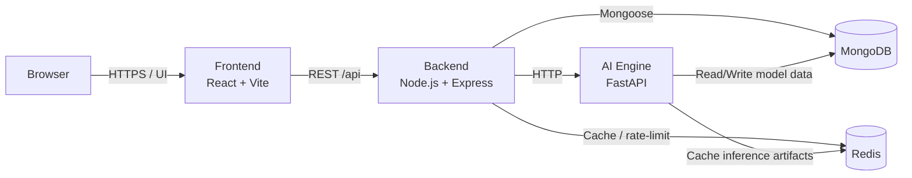
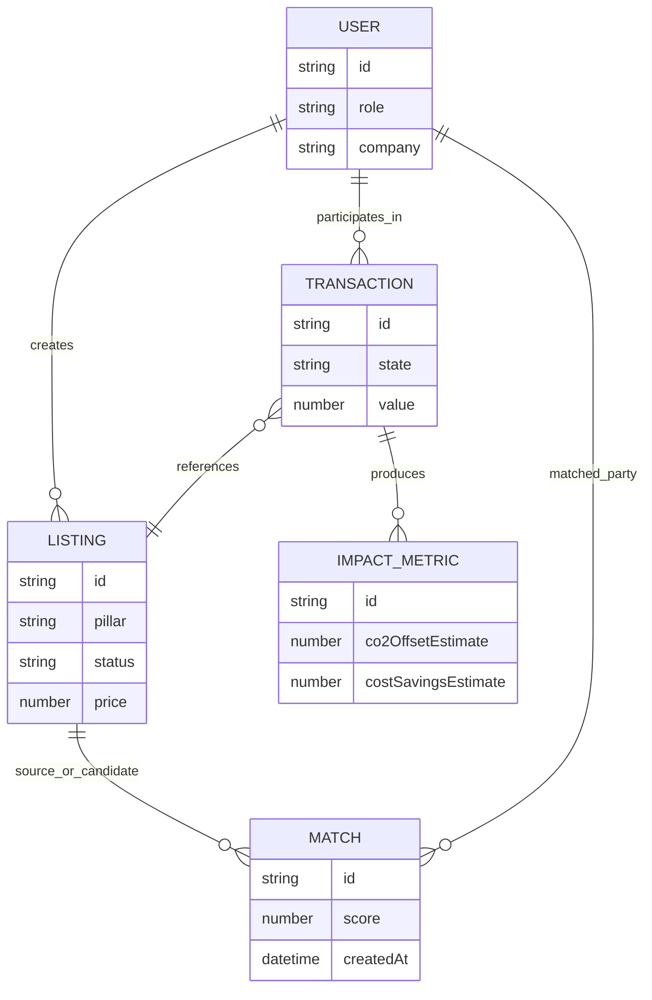

# Eco_Nexus 🌿

> AI-powered B2B circular economy marketplace for waste, machinery, labor, and workspace sharing.

[](https://github.com/Praveen-K-0503/Eco_Nexus/actions/workflows/ci.yml)
[](https://github.com/Praveen-K-0503/Eco_Nexus/actions/workflows/deploy.yml)
[](./LICENSE)


**Status:** Active development (foundation/scaffolding stage; many product endpoints and UI flows are planned but not yet implemented in this branch).

## Table of Contents

- [Problem Statement and Product Vision](#problem-statement-and-product-vision)
- [Marketplace Pillars](#marketplace-pillars)
- [Current vs Planned Capabilities](#current-vs-planned-capabilities)
- [High-Level Architecture](#high-level-architecture)
- [System Interaction Diagram](#system-interaction-diagram)
- [Lifecycle Workflow](#lifecycle-workflow)
- [Domain/Data Model](#domaindata-model)
- [Tech Stack and Rationale](#tech-stack-and-rationale)
- [Repository Structure](#repository-structure)
- [Local Setup (Docker Compose)](#local-setup-docker-compose)
- [Run Without Docker](#run-without-docker)
- [Environment Configuration](#environment-configuration)
- [Testing, Linting, Type-Checking, and CI](#testing-linting-type-checking-and-ci)
- [API and Service Overview](#api-and-service-overview)
- [Security and Data Handling](#security-and-data-handling)
- [Contribution Workflow](#contribution-workflow)
- [Documentation Index](#documentation-index)
- [Troubleshooting](#troubleshooting)
- [Roadmap and Project Status](#roadmap-and-project-status)
- [License](#license)
- [Support / Contact](#support--contact)

## Problem Statement and Product Vision

Industrial ecosystems often waste reusable materials, underutilize machinery, face labor-demand mismatch, and leave workspace idle. Eco_Nexus aims to turn these inefficiencies into a circular B2B exchange network where businesses can:

- reduce disposal and procurement costs,
- increase asset utilization,
- improve operational resilience,
- and measure environmental impact (for example, reduced landfill contribution and avoided emissions).

## Marketplace Pillars

Eco_Nexus is organized into four core B2B exchanges:

| Pillar | Primary Users | Example Listing | Example Outcome |
|---|---|---|---|
| ♻️ Waste Exchange | Manufacturers, recyclers, processors | “Copper wire offcuts, 500 kg” | Seller monetizes scrap; buyer sources lower-cost raw input |
| 🏗️ Machinery Sharing | Equipment owners, factories, contractors | “Idle CNC machine, daily/weekly rental” | Owner earns from idle assets; renter avoids capex |
| 👷 Labor Pooling | Staffing firms, SMEs, seasonal operators | “Certified welders available for 3-week shift” | Demand spikes covered without full-time hiring |
| 🏭 Workspace Sharing | Warehouse owners, cold-chain operators, SMEs | “Unused warehouse section, 2,000 sq ft” | Owner improves occupancy; tenant gets short-term capacity |

## Current vs Planned Capabilities

The repository currently contains foundational service scaffolding and documentation for a broader product scope.

| Area | Current in repository | Planned / In-progress |
|---|---|---|
| Frontend | Vite + React + TypeScript app with basic router shell (`/`) | Full premium UI/UX flows (landing, auth, dashboard, marketplace routes) described in docs/roadmap |
| Backend | Express server, security middleware, `/health`, `/api` base response | Auth, listing CRUD, booking, transactions, notifications, RBAC endpoints |
| AI Engine | FastAPI service with `/`, `/health`, OpenAPI docs (`/docs`) | Matching endpoints (`/match/*`) and price recommendation APIs |
| Infrastructure | Dockerfiles, `docker-compose.yml`, CI + deploy workflows | Production hardening, expanded observability, launch-readiness |

> For target feature behavior and contracts, refer to [`docs/FEATURE_SPECS.md`](./docs/FEATURE_SPECS.md) and [`docs/API_SPEC.md`](./docs/API_SPEC.md).

## High-Level Architecture

Eco_Nexus uses a multi-service architecture:

- **Browser + Frontend (`frontend/`)**: React SPA for user workflows.
- **Backend API (`backend/`)**: Express service for business logic, auth, and orchestration.
- **AI Engine (`ai-engine/`)**: FastAPI service for matching and recommendations.
- **MongoDB**: primary document store.
- **Redis**: caching/session/rate-limit support.

## System Interaction Diagram



## Lifecycle Workflow

```mermaid
flowchart TD
    A[Business creates listing] --> B[Platform validates and publishes]
    B --> C[Matching engine ranks counterparties]
    C --> D[Buyer/Seller negotiation or booking request]
    D --> E[Agreement and transaction confirmation]
    E --> F[Fulfillment and completion]
    F --> G[Impact tracking\n(cost savings, reuse, emissions proxy)]
```

## Domain/Data Model



## Tech Stack and Rationale

| Layer | Stack | Why this choice |
|---|---|---|
| Frontend | React 18, TypeScript, Vite, TailwindCSS | Fast iteration, strong typing, modern DX |
| Backend | Node.js, Express, TypeScript | Widely adopted API stack, straightforward service composition |
| AI Service | Python 3.11, FastAPI, scikit-learn, pandas | Rapid model/API development with strong ML ecosystem |
| Data | MongoDB, Redis | Flexible listing schemas + low-latency cache/state |
| DevOps | Docker, Docker Compose, GitHub Actions | Consistent local environment and automated checks |

## Repository Structure

```text
Eco_Nexus/
├── frontend/                 # React + TypeScript frontend service
│   ├── src/
│   └── .env.example
├── backend/                  # Node.js + Express backend service
│   ├── src/
│   └── .env.example
├── ai-engine/                # FastAPI AI service
│   ├── src/
│   └── .env.example
├── docs/                     # Detailed architecture, API, security, setup docs
├── .github/workflows/        # CI and deployment workflows
├── docker-compose.yml        # Multi-service local orchestration
├── CONTRIBUTING.md
└── README.md
```

## Local Setup (Docker Compose)

### Prerequisites

- Docker + Docker Compose v2
- Git
- (Optional for non-Docker flows) Node.js 20+, npm, Python 3.11

### Quick Start

```bash
git clone https://github.com/Praveen-K-0503/Eco_Nexus.git
cd Eco_Nexus

cp frontend/.env.example frontend/.env
cp backend/.env.example backend/.env
cp ai-engine/.env.example ai-engine/.env

docker compose up --build
```

### Service URLs

- Frontend: http://localhost:3000
- Backend API: http://localhost:5000
- Backend health: http://localhost:5000/health
- AI Engine: http://localhost:8000
- AI Engine health: http://localhost:8000/health
- AI Engine OpenAPI docs: http://localhost:8000/docs
- MongoDB: `mongodb://localhost:27017`
- Redis: `redis://localhost:6379`

## Run Without Docker

### Frontend

```bash
cd frontend
npm install
npm run dev
```

### Backend

```bash
cd backend
npm install
npm run dev
```

### AI Engine

```bash
cd ai-engine
python -m venv .venv
source .venv/bin/activate
pip install -r requirements.txt
uvicorn src.main:app --reload --port 8000
```

## Environment Configuration

Use service-level env examples as source of truth:

- [`frontend/.env.example`](./frontend/.env.example)
- [`backend/.env.example`](./backend/.env.example)
- [`ai-engine/.env.example`](./ai-engine/.env.example)

Key variables (examples only, do not commit secrets):

| Service | Variables |
|---|---|
| Frontend | `VITE_API_BASE_URL`, `VITE_AI_ENGINE_URL`, `VITE_APP_NAME`, `VITE_APP_VERSION` |
| Backend | `PORT`, `MONGODB_URI`, `JWT_SECRET`, `JWT_REFRESH_SECRET`, `REDIS_URL`, `AI_ENGINE_URL`, `CORS_ORIGIN`, SMTP and upload/rate-limit settings |
| AI Engine | `MONGODB_URI`, `REDIS_URL`, `MODEL_PATH`, `LOG_LEVEL` |

## Testing, Linting, Type-Checking, and CI

### Local Commands (from repo scripts/docs)

- Frontend lint: `cd frontend && npm run lint`
- Frontend tests: `cd frontend && npm run test`
- Frontend build (includes `tsc`): `cd frontend && npm run build`
- Backend lint: `cd backend && npm run lint`
- Backend tests: `cd backend && npm run test`
- Backend compile (TypeScript): `cd backend && npm run build`
- AI engine tests (documented): `cd ai-engine && pytest --cov=src --cov-report=term-missing`

> Note: dedicated standalone `typecheck` scripts are not currently defined in `frontend/package.json` or `backend/package.json`.

### CI Workflows

- [`CI`](./.github/workflows/ci.yml): frontend lint/test, backend lint/test, AI pytest.
- [`Deploy`](./.github/workflows/deploy.yml): frontend deployment + backend/AI deployment jobs.

This README does **not** assume all CI jobs are currently green for every branch/PR; check the Actions tab for current run status.

## API and Service Overview

| Service | Available now in code | Planned contract docs |
|---|---|---|
| Backend (`backend`) | `GET /health`, `GET /api` | [`docs/API_SPEC.md`](./docs/API_SPEC.md) |
| AI Engine (`ai-engine`) | `GET /`, `GET /health`, `GET /docs` | AI endpoint plan in [`docs/FEATURE_SPECS.md`](./docs/FEATURE_SPECS.md) |
| Frontend (`frontend`) | SPA shell route (`/`) | UX scope in [`docs/FEATURE_SPECS.md`](./docs/FEATURE_SPECS.md), [`docs/USER_STORIES.md`](./docs/USER_STORIES.md) |

## Security and Data Handling

- Follow [`docs/SECURITY.md`](./docs/SECURITY.md) for auth, token handling, RBAC, CORS, and incident response guidance.
- Never commit `.env` secrets.
- Use placeholder values in examples only.
- Report vulnerabilities privately per security policy.

## Contribution Workflow

See [`CONTRIBUTING.md`](./CONTRIBUTING.md).

Typical flow:

1. Create a feature branch.
2. Make focused changes with tests/docs updates as needed.
3. Run relevant lint/test/build commands.
4. Open a pull request with clear scope.

## Documentation Index

- [Architecture](./docs/ARCHITECTURE.md)
- [API Specification](./docs/API_SPEC.md)
- [Database Schema](./docs/DATABASE_SCHEMA.md)
- [Development Roadmap](./docs/DEVELOPMENT_ROADMAP.md)
- [Feature Specs](./docs/FEATURE_SPECS.md)
- [User Stories](./docs/USER_STORIES.md)
- [Security](./docs/SECURITY.md)
- [Testing Strategy](./docs/TESTING_STRATEGY.md)
- [Design System](./docs/DESIGN_SYSTEM.md)
- [Setup Guide](./docs/SETUP.md)
- [Tech Stack](./docs/TECH_STACK.md)

## Troubleshooting

- **Ports already in use**: stop conflicting local services/containers, then retry.
- **Containers unhealthy**: run `docker compose ps` and inspect logs with `docker compose logs -f <service>`.
- **Backend cannot reach DB/Redis**: verify `MONGODB_URI` and `REDIS_URL` in `backend/.env`.
- **AI Engine import/runtime issues**: recreate venv and reinstall `ai-engine/requirements.txt`.
- **Frontend cannot call APIs**: verify `frontend/.env` URLs and CORS origin in backend env.

## Roadmap and Project Status

- Current state aligns with early foundation milestones (service scaffolds, Docker setup, CI/deploy workflows, and extensive planning docs).
- Core marketplace CRUD flows, auth workflows, advanced UI routes, and AI matching endpoints are documented but still in-progress/planned in this branch.
- See [`docs/DEVELOPMENT_ROADMAP.md`](./docs/DEVELOPMENT_ROADMAP.md) for phased milestones.

## License

Licensed under the [MIT License](./LICENSE).

## Support / Contact

- Use GitHub Issues for feature requests and non-sensitive bugs.
- For security issues, follow the private disclosure guidance in [`docs/SECURITY.md`](./docs/SECURITY.md).
